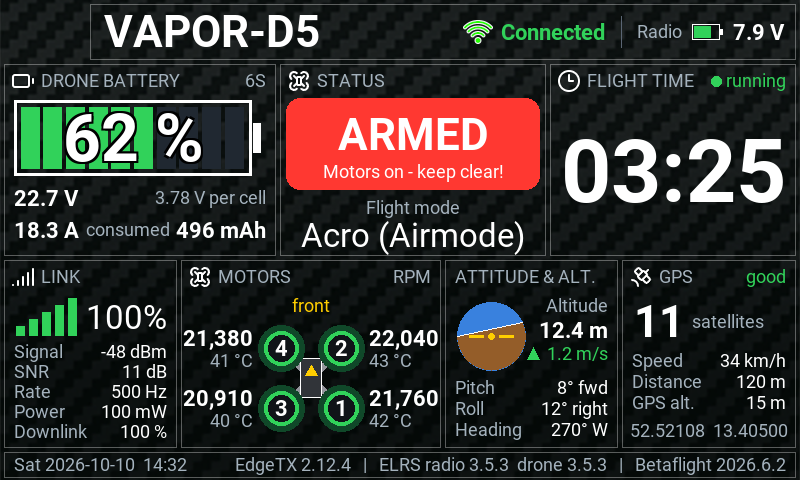
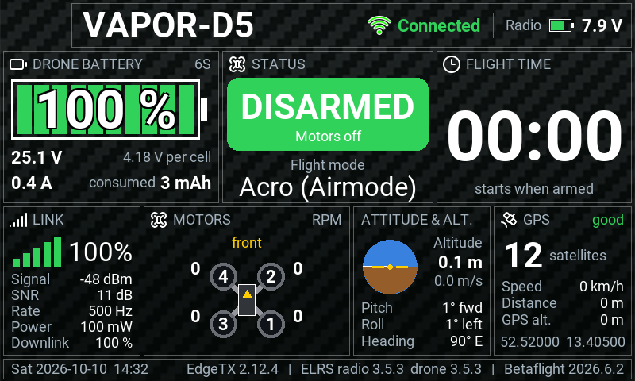
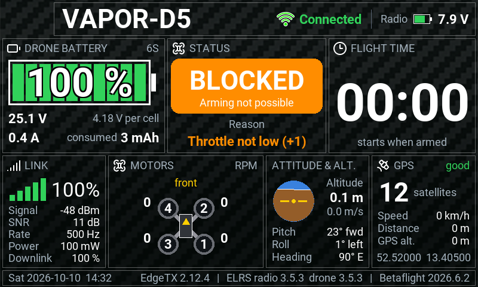
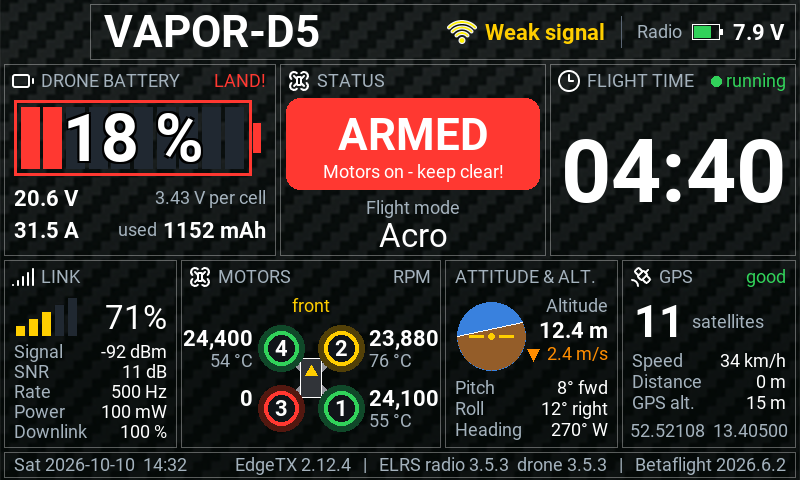
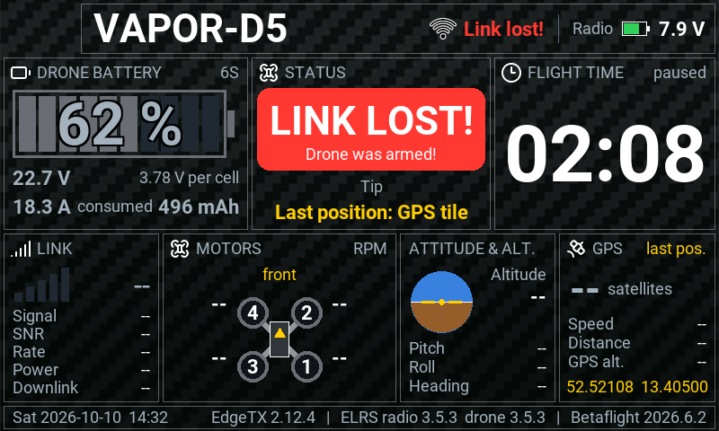
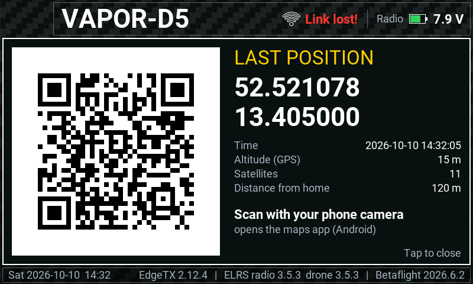

# Vapor Dashboard

**English** | [Deutsch](README.de.md)

Telemetry widget for **EdgeTX** on the **RadioMaster TX16S MK3** (800×480), built for the
**GEPRC Vapor-D5 HD O4 Pro** with Betaflight and ExpressLRS. It puts everything the drone
transmits on one screen. Battery, flight time and arming status are shown large and in
traffic-light colours, so even a child can read it at a glance.



## Features

- **Drone battery** as a large gauge with percentage, voltage (pack and per cell), current
  and consumed mAh. Below 25 % it flashes "LAND!".
- **Arming status** in plain words: DISARMED, ARMED, BLOCKED (with the reason, e.g.
  "Throttle not low"), FAILSAFE, or NO SIGNAL. The flight mode is shown below.
- **Flight time** that only runs while the drone is armed. A new battery resets it.
- **Motors** drawn as a top view of the quad, with the RPM of each motor and ESC temperature.
- **Link:** link quality, signal, SNR, packet rate, TX power and downlink quality.
- **Attitude & altitude:** artificial horizon, altitude, climb/sink rate, pitch, roll, heading.
- **GPS:** satellites, speed, distance from the arming point, coordinates.
- **QR code of the last position:** tap the GPS tile, scan with your phone, navigate to the
  drone. The position is saved to the SD card and survives a restart of the radio.
- **Versions** of EdgeTX, ELRS (radio and drone) and Betaflight in the footer.

## Screenshots

| | |
|:---:|:---:|
|  |  |
| Disarmed and ready | Arming blocked, with reason |
|  |  |
| Battery low, motor 3 stopped, motor 2 warm | Link lost in flight, last position in yellow |



*The images come from the PC preview with simulated telemetry, at the original size and with
the EdgeTX fonts.*

## Requirements

- **Radio:** RadioMaster TX16S MK3 (800×480) with **EdgeTX 2.12** or newer
  (tested with 2.12.4).
- **Link:** ExpressLRS with CRSF telemetry (e.g. the internal module of the TX16S MK3).
- **Drone:** flight controller running **Betaflight** with telemetry enabled
  (developed with Betaflight 2026.6.2).
- **Optional:**
  - **GPS module:** for the GPS tile and the QR code.
  - **Motor RPM:** needs bidirectional DShot. With BLHeli_S ESCs this only works with
    Bluejay firmware.

## Installation on the RadioMaster TX16S MK3

### 1. Download

On GitHub choose **Code → Download ZIP** and unpack it, or clone the repository.
Only the folder `WIDGETS/VAPORDASH` is needed.

### 2. Copy it to the SD card

1. Switch on the radio and connect it to the PC via USB-C.
2. On the radio choose **USB Storage (SD)**. The SD card appears as a drive on the PC.
3. Copy the folder `VAPORDASH` into the `WIDGETS` folder of the SD card. You should then
   have `/WIDGETS/VAPORDASH/main.lua`.
4. Eject the drive on the PC and unplug the USB cable.

### 3. Discover the telemetry sensors

1. Select the drone's model, power up the drone and wait until it is connected.
2. Press **MDL**, go to the **Telemetry** page and choose **Discover new**.
3. Wait until sensors such as `RxBt`, `FM`, `RQly` and `Ptch` appear, then choose **Stop**.

The GPS sensors (`GPS`, `Sats`) only appear once the drone's GPS delivers data. If needed,
run the discovery again later outdoors.

### 4. Set up the screen

1. Press **TELE** briefly. **UI Setup** opens with the screens (*Screen 1, 2, …*).
   Pick a screen or add a new one with **+**.
2. Set **Layout** to **App mode** (one widget covering the whole screen).
3. Choose **Setup widgets**, tap the area and select **Vapor Dashboard**. The widget
   settings open afterwards (see below).
4. Press **RTN** to return to the main screen.

### 5. Enable touch (for the QR code)

In App mode, EdgeTX only passes taps to the widget after you **long-press the screen once**.
Until then the header shows "For touch: long-press". Leave this mode with a **long press on
RTN**. You need to do this again after restarting the radio.

### Updating to a new version

Copy the folder `WIDGETS/VAPORDASH` to the SD card again and overwrite the files. The saved
position (`lastpos.txt`) is kept. If changes don't show up, delete the `.luac` files in the
folder on the SD card. EdgeTX recreates them on the next start.

## Settings

### Widget

| Setting | Meaning |
|---|---|
| Battery cells (0 = auto) | Default 6 (6S). With 0 the widget estimates the cell count from the voltage. |
| Poll motor RPM | Off / Normal / Fast. Fast updates more often but uses more link bandwidth. |

### Betaflight

| What | How |
|---|---|
| Telemetry | Receiver tab: enable telemetry output |
| Battery % | `set bat_capacity = 1300` (your pack size), calibrate current and voltage in the Power & Battery tab |
| Pack voltage | keep `report_cell_voltage` off (default) |
| Motor RPM | `set dshot_bidir = ON`, `set motor_poles = 14` (BLHeli_S only with [Bluejay](https://esc-configurator.com)) |
| ESC temperatures | additionally `set dshot_edt = ON` (Bluejay 0.20 or newer) |
| GPS | Configuration tab: enable GPS (UBLOX); Ports tab: GPS on the right UART |

Then type `save`. The reasoning behind each setting is in the detailed guide
[docs/ANLEITUNG.md](docs/ANLEITUNG.md) (German).

## QR code with the last position

1. Enable touch (long-press the screen).
2. **Tap the GPS tile.** A window opens with the QR code, coordinates, time, altitude and
   distance from the arming point.
3. Scan it with the phone camera. Android opens the maps app with a pin.
4. Tap the window to close it.

The code contains a `geo:` link, e.g. `geo:52.521078,13.405000?q=52.521078,13.405000(VAPOR-D5)`.
The iPhone camera does not recognise `geo:` links. On an iPhone, type in the coordinates
shown in the window.

## What do the messages mean?

| Shown on screen | Meaning and fix |
|---|---|
| **For touch: long-press** (header) | Taps don't reach the widget yet. Long-press the screen once. |
| **NO SIGNAL** | No link to the drone: battery unplugged or out of range. |
| **LINK LOST!** (flashing) | Link lost in flight. The last position is shown in yellow in the GPS tile and the QR code. |
| **BLOCKED** + reason | Betaflight blocks arming. The reason is shown below, e.g. "Throttle not low". |
| **STATUS ?** | The flight mode sensor `FM` is missing. Check telemetry in Betaflight and discover sensors again. |
| Motors: **waiting for data...** | Waiting for Betaflight's reply. Over ELRS this takes a few seconds. |
| Motors: **ESC sends no RPM** | Bidirectional DShot is on, but the ESC doesn't reply (BLHeli_S without Bluejay). Flash Bluejay or set `dshot_bidir = OFF`. |
| Motors: **No RPM: bidir. DShot on?** | The drone is armed but all RPMs are 0: `dshot_bidir` is off. |
| GPS: **missing** / **No GPS data** | Betaflight sends no GPS data. Enable GPS in Betaflight and discover sensors again. |
| GPS: **no fix yet** | The GPS delivers data but has no fix yet. Go outdoors and wait a few minutes. |

If the dashboard is replaced by a message such as `ERROR in refresh(): …`, please report it
as an issue.

## More documentation

- **[docs/ANLEITUNG.md](docs/ANLEITUNG.md)** (German): detailed guide. It explains how the
  values are derived (arming detection, flight time, MSP requests), what to check on the real
  radio, and how the PC preview works.
- **[design/](design/):** first sketch, wireframe and early preview images.
- **[docs/EdgeTX_Handbuch_DE.pdf](docs/EdgeTX_Handbuch_DE.pdf):** EdgeTX user manual in German.

## Project structure

```
WIDGETS/VAPORDASH/      goes onto the SD card into /WIDGETS/
  main.lua              widget entry point, options, touch
  lib/telemetry.lua     sensors, status, flight time, battery, GPS, saved position
  lib/crsf.lua          MSP requests to Betaflight, ELRS device info
  lib/ui.lua            drawing of all tiles and the QR window
  lib/qr.lua            QR code generator
  icons/, images/       icons and background image
tools/preview/          PC preview (Lua 5.3 + emulated EdgeTX API)
docs/                   guide, screenshots, EdgeTX manual
design/                 sketches and preview images
```

## Credits

- **Icons** (battery, clock, drone, signal, satellite, link) come from the widget
  [edgetx-telemetry-dashboard](https://github.com/dbarrios83/edgetx-telemetry-dashboard)
  by dbarrios83, whose layout also inspired the design.
- **QR code generation** follows the reference implementation by
  [Project Nayuki](https://www.nayuki.io/page/qr-code-generator-library) (MIT licence).
- **German EdgeTX manual:** translation of the EdgeTX User Manual, CC BY-SA 4.0
  (details in the PDF).
