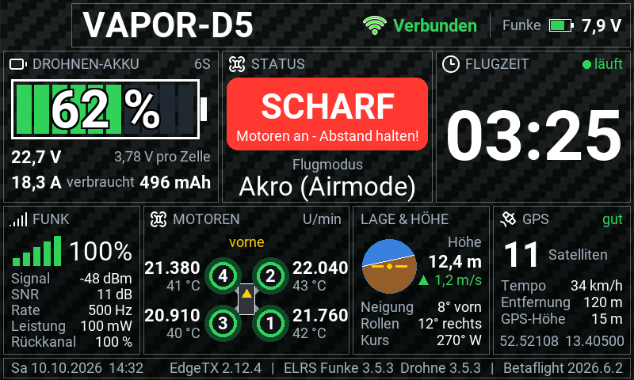

# Vapor Dashboard: ausführliche Anleitung

Telemetrie-Dashboard für die **RadioMaster TX16S MK3** (EdgeTX 2.12, 800×480)
und die **GEPRC Vapor-D5 HD O4 Pro** (Betaflight, ELRS 2,4 GHz, GPS).
Es zeigt alles, was die Drohne über ELRS liefert, und ist so gebaut, dass
man es auf einen Blick versteht. Grün heißt gut, gelb heißt aufpassen,
rot heißt Gefahr.



Alle Zustände (gesichert, scharf, gesperrt, Akku leer, Failsafe, kein Signal …):
[design/mockups/vorschau_alle_zustaende.png](../design/mockups/vorschau_alle_zustaende.png)

## Aufbau

| Bereich | Inhalt |
|---|---|
| **Kopfzeile** | Modellname, Verbindung (Funk-Symbol), Akku der Funke |
| **Drohnen-Akku** (groß) | Akku-Balken mit %, Spannung gesamt und pro Zelle, Strom, verbrauchte mAh. Unter 25 % blinkt „LANDEN!“ |
| **Status** (groß) | GESICHERT / SCHARF / GESPERRT (mit Grund) / FAILSAFE / KEIN SIGNAL, darunter der Flugmodus |
| **Flugzeit** (groß) | läuft nur, solange die Drohne scharf ist |
| **Motoren** | Drohne von oben, Drehzahl jedes Motors (U/min), ESC-Temperatur falls vorhanden |
| **Funk** | Verbindungsqualität als Balken, Signal (dBm), SNR, Paketrate, Sendeleistung, Rückkanal |
| **Lage & Höhe** | künstlicher Horizont, Höhe, Steigen/Sinken, Neigung, Rollen, Kurs |
| **GPS** | Satelliten, Tempo, Entfernung zum Startpunkt, GPS-Höhe, Koordinaten |
| **Fußzeile** | Datum, Uhrzeit, Versionen von EdgeTX, ELRS (Funke + Drohne) und Betaflight |

## Installation

1. Funke per USB verbinden und **USB-Speicher (SD)** wählen.
2. Den Ordner `WIDGETS/VAPORDASH` aus diesem Projekt nach `/WIDGETS/` auf die
   SD-Karte kopieren. Danach gibt es dort `/WIDGETS/VAPORDASH/main.lua`.
3. Falls dort noch `/WIDGETS/FPVDASH` vom alten Beispiel liegt, kann der Ordner weg.
4. Drohne einschalten, an der Funke **Modell → Telemetrie → Neue Sensoren suchen**.
5. Bildschirm einrichten: **TELE** drücken → Bildschirm wählen → Layout **App-Modus**
   (Vollbild) → Widget **Vapor Dashboard** auswählen.

## QR-Code mit der letzten Position

1. **Touch einschalten:** einmal **lange auf den Bildschirm drücken**. EdgeTX gibt
   Fingertipps erst dann an das Widget weiter (Vollbild-Modus). Solange das nicht passiert
   ist, steht in der Kopfzeile „Für Touch: lang drücken“. Zurück in den normalen Modus geht
   es mit **langem Druck auf RTN**.
2. **GPS-Kachel antippen**, dann öffnet sich ein Fenster mit einem QR-Code der
   Drohnen-Position. Ein Tipp auf das Fenster schließt es wieder.

Mit der Handy-Kamera gescannt, öffnet sich auf Android die Karten-App mit einer Stecknadel
an der Position. Von dort kannst du direkt zur Drohne navigieren.

- **Inhalt des Codes:** ein `geo:`-Link, z. B. `geo:52.521078,13.405000?q=52.521078,13.405000(VAPOR-D5)`.
  Die iPhone-Kamera erkennt `geo:`-Links nicht. Dort die Koordinaten aus dem Fenster abtippen.
- **Position festgehalten:** Der Code zeigt die Position beim Öffnen. Ist die Drohne verbunden,
  steht dort „AKTUELLE POSITION“, sonst „LETZTE POSITION“. Für einen neuen Stand das Fenster
  schließen und neu öffnen.
- **Daneben:** Koordinaten, Uhrzeit, GPS-Höhe, Satelliten und Entfernung zum Start.
- **Gesichert auf der SD-Karte:** Die letzte Position steht in
  `/WIDGETS/VAPORDASH/lastpos.txt`. Sie wird höchstens alle 5 Sekunden gespeichert (nur wenn
  sich die Drohne mindestens 3 m bewegt hat) und sofort, wenn die Verbindung abreißt. So ist
  sie nach einem Absturz auch dann noch da, wenn die Funke zwischendurch aus war.
- **Erstellung:** Den Code berechnet das Widget selbst. EdgeTX erlaubt einem Widget nur
  begrenzte Rechenzeit pro Bild, deshalb steht nach dem Antippen kurz „QR wird erstellt…“.

## Hintergrund

Das Widget zeichnet `images/background.png` (Carbon, 800×480) selbst als Hintergrund.
Die Kacheln sind durchsichtig und haben nur einen feinen Rahmen. Ein Theme ist dafür nicht
nötig, der Rest der Funke bleibt unverändert. Für ein anderes Bild die Datei durch ein
eigenes PNG mit 800×480 Pixeln ersetzen. Fehlt das Bild oder kann EdgeTX es nicht laden,
zeichnet das Widget einen dunklen Farbverlauf.

## Widget-Einstellungen

| Einstellung | Bedeutung |
|---|---|
| Akku-Zellen (0 = automatisch) | Standard 6 (6S). Bei 0 wird die Zellzahl aus der Spannung geschätzt. |
| Motor-Drehzahl abfragen | Aus / Normal / Schnell. „Schnell“ aktualisiert öfter, braucht aber mehr Funk-Bandbreite. |

## Einstellungen in Betaflight (2026.6)

- **Telemetrie an:** Im Tab „Empfänger“ muss „Telemetrie-Ausgabe“ eingeschaltet sein.
- **`report_cell_voltage` aus lassen** (Standard). Das Widget erwartet die Spannung des ganzen Packs.
- **Akku-%:** Betaflight rechnet so:
  - **Mit `bat_capacity`:** Restladung = (Kapazität − verbrauchte mAh) / Kapazität.
  - **Ohne `bat_capacity` (0):** aus der Spannung zwischen 3,30 und 4,30 V pro Zelle. Ein voller Akku zeigt dann etwa 90 %.

  Also die Akkugröße eintragen (`set bat_capacity = 1300`) und im Tab „Strom & Akku“
  Spannung und Strom kalibrieren. Ein falsch kalibrierter Stromsensor lässt die
  verbrauchten mAh zu schnell steigen, und dann stimmt der Akku-% nicht.
- **Motordrehzahlen** brauchen bidirektionales DShot (`set dshot_bidir = ON`,
  `set motor_poles = 14`). Die ESC TAKER H60 (BLHeli_S) kann das **nur mit
  Bluejay-Firmware**, nicht mit dem originalen BLHeli_S 16.7. Prüfen und flashen geht mit
  [esc-configurator.com](https://esc-configurator.com) (Propeller ab!). Mit bidirektionalem
  DShot an, aber ohne Bluejay, sperrt Betaflight den Start. Das Widget zeigt dann
  „GESPERRT, Motor-Telemetrie fehlt“.
- **ESC-Temperaturen** zusätzlich mit `set dshot_edt = ON` (Bluejay 0.20 oder neuer).
- **GPS:** Im Tab „Konfiguration“ GPS einschalten (Protokoll UBLOX, Auto-Konfiguration an),
  im Tab „Anschlüsse“ am richtigen UART „GPS“ wählen. Den ersten Fix gibt es nur unter freiem
  Himmel, und er dauert einige Minuten. Die DJI-O4-Einheit stört den GPS-Empfang zusätzlich.
  Erst wenn das GPS Daten liefert, an der Funke noch einmal **Neue Sensoren suchen**.

## So funktioniert's

- **Scharf oder gesichert** liest das Widget am Flugmodus-Sensor `FM` ab. Betaflight hängt
  `*` an (gesichert), `!` (Start gesperrt) oder `?` (GPS-Rettung noch nicht bereit).
  Steht kein Zeichen dran, ist die Drohne scharf.
- **Motordrehzahlen, Sperrgründe und Betaflight-Version** stehen nicht in der normalen
  ELRS-Telemetrie. Das Widget fragt sie per MSP direkt bei Betaflight ab, so wie es
  die Betaflight-Lua-Skripte tun. Das passiert nur, solange das Dashboard sichtbar ist.
- **Flugzeit:** Sie zählt nur, solange die Drohne scharf ist, und läuft auch weiter, wenn ein
  anderer Bildschirm angezeigt wird. Ein neuer Akku setzt sie zurück. Das erkennt das Widget
  so: Die Verbindung war mindestens 3 Sekunden weg, während die Drohne gesichert war,
  oder der mAh-Zähler der Drohne hat neu bei 0 angefangen.
- **Startpunkt für die Entfernung** wird beim Scharfschalten gesetzt (vorher: erster guter GPS-Fix).
- **Verbindung im Flug verloren:** Das Status-Feld blinkt rot, und das GPS-Feld zeigt die
  letzte bekannte Position in Gelb. Das hilft beim Suchen der Drohne.

## Am echten Gerät noch zu prüfen

Das Widget wurde mit einer nachgebauten EdgeTX-Umgebung getestet (siehe unten), noch nicht
auf der Funke selbst. Beim ersten Einsatz bitte auf Folgendes achten:

- **Künstlicher Horizont:** Drohne mit der Nase nach unten kippen. Der Horizont muss nach oben
  wandern, und unter „Neigung“ muss „vorn“ stehen. Wenn es falsch herum ist, in
  `lib/ui.lua` bei `drawHorizon` das Vorzeichen von `noseUp` umdrehen.
- **Motor-Abfrage im Flug:** Wenn die Drehzahlen zu träge kommen, im ELRS-Lua-Skript ein
  höheres Telemetrie-Verhältnis wählen (z. B. 1:4) oder die Abfrage auf „Schnell“ stellen.
  Bei Problemen die Abfrage auf „Aus“ stellen.

## Vorschau am PC

`tools/preview/preview.py` führt den Widget-Code mit Lua 5.3 (wie EdgeTX 2.12) und einer
nachgebauten EdgeTX-API aus. Dabei werden Telemetrie, Betaflight-Antworten und ELRS-Infos
simuliert. Heraus kommt pro Situation ein Bild in Originalgröße.

```
python -m venv venv
venv\Scripts\pip install lupa pillow
venv\Scripts\python tools\preview\preview.py
```

Die Bilder landen in `tools/preview/out/`. Die Schriften (Roboto, wie in EdgeTX) werden
beim ersten Start heruntergeladen.

Die Vorschau bildet einige Eigenheiten von EdgeTX nach:
- **Keine Text-Methoden:** `s:gsub(...)` geht nicht, nur `string.gsub(s, ...)`.
- **Fehlende Bibliotheken:** `coroutine`, `debug`, `os` und `utf8` gibt es in der
  Widget-Umgebung nicht.
- **CPU-Limit:** etwa 20.000 Lua-Befehle pro Bildaufbau. Die Vorschau zeigt den höchsten
  Verbrauch als „CPU max“.
- **Langsame Leitung:** Antworten von Betaflight kommen über ELRS nur mit wenigen Byte pro
  Sekunde zurück.
- **SD-Karte und Antippen:** Beides wird simuliert.

Mit `pip install zxing-cpp` liest die Vorschau die erzeugten QR-Codes zusätzlich zur
Kontrolle zurück. Nicht nachgebildet ist, dass EdgeTX mit 32-Bit-Ganzzahlen und einfach
genauen Kommazahlen rechnet.

## Projektstruktur

```
WIDGETS/VAPORDASH/      -> kommt auf die SD-Karte nach /WIDGETS/
  main.lua              Widget-Einstieg, Optionen
  lib/telemetry.lua     Sensoren, Scharf/Gesichert, Flugzeit, Akku, GPS
  lib/crsf.lua          MSP-Abfragen an Betaflight, ELRS-Geräteinfos
  lib/ui.lua            Zeichnen aller Felder und des QR-Fensters
  lib/qr.lua            QR-Code-Erzeuger (über mehrere Bilder verteilt)
  lastpos.txt           wird auf der SD-Karte angelegt: letzte GPS-Position
  icons/                Symbole
  images/background.png Hintergrundbild (800x480), Kacheln sind durchsichtig
design/                 Skizze, Wireframe, Vorschaubilder
docs/                   EdgeTX-Handbuch (Deutsch)
tools/preview/          PC-Vorschau
```
